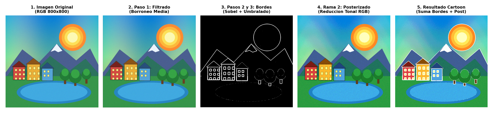
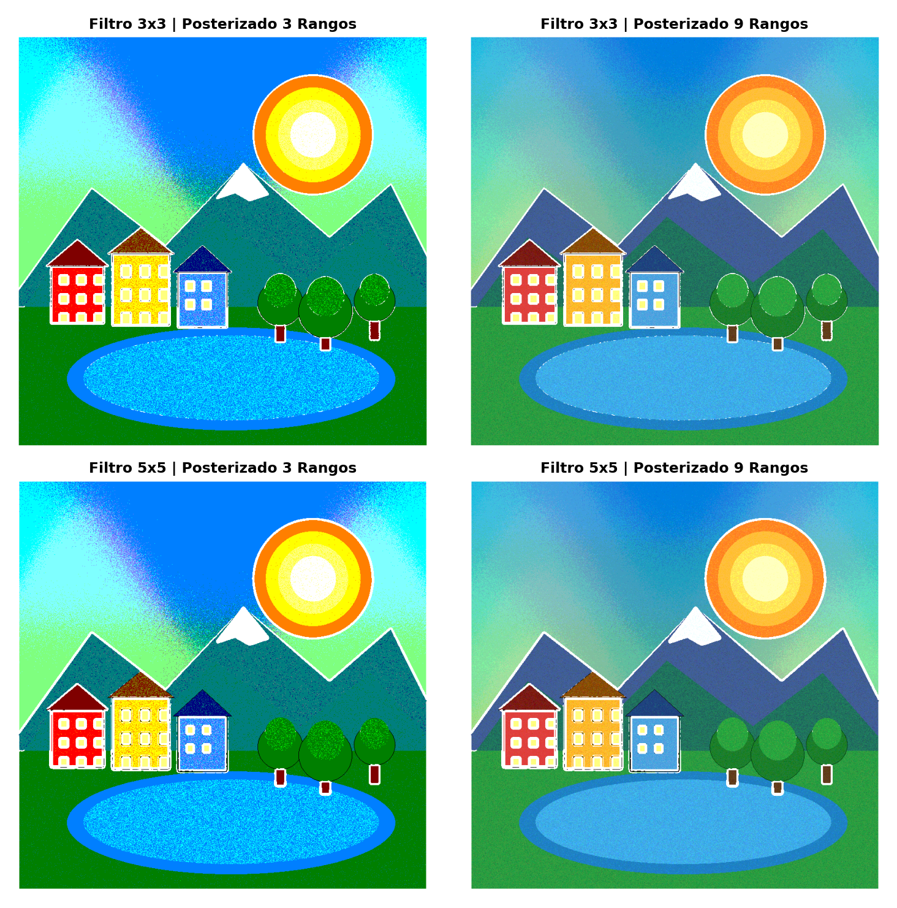
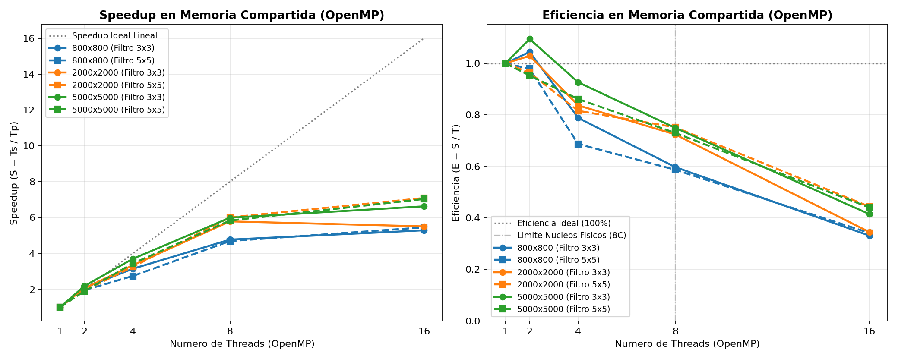
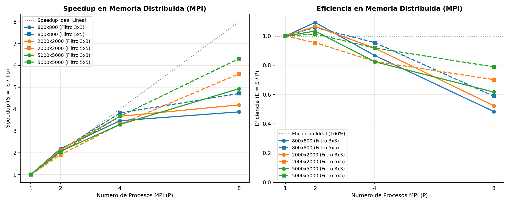
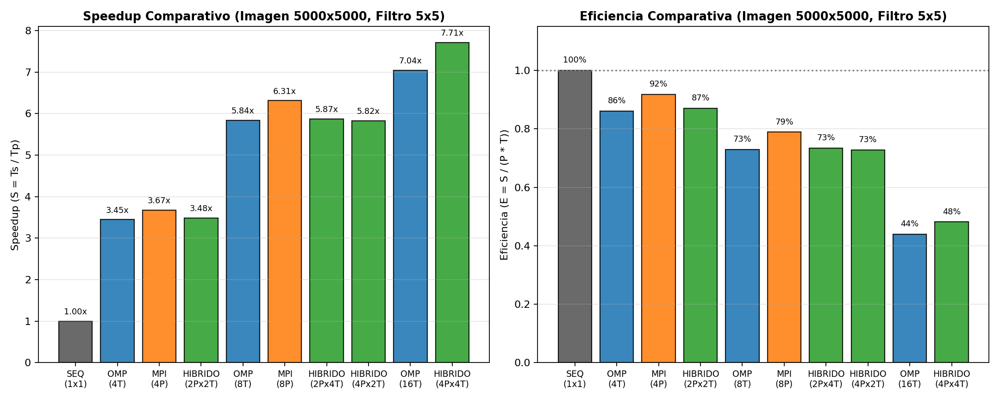
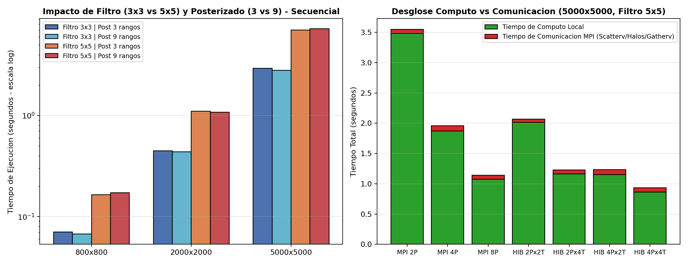

# Informe Técnico — Trabajo Práctico Final Integrador
## Generación de Cartoons a partir de Imágenes en Sistemas de Memoria Compartida (OpenMP), Memoria Distribuida (MPI) e Híbridos (MPI + OpenMP)

**Universidad Autónoma de Entre Ríos (UADER) — Facultad de Ciencia y Tecnología (FCyT)**  
**Carrera:** Licenciatura en Sistemas de Información  
**Cátedra:** Computación Avanzada (4° Año)  
**Docente:** Dra. María Fabiana Piccoli  
**Alumnos:** Carballo Tobías, Dacuy Santino  
**Fecha de entrega:** 6 de noviembre de 2026  

---

## 1. Introducción y Marco Teórico: Computación Paralela Híbrida

### 1.1. Motivación
El procesamiento digital de imágenes de alta resolución demanda aplicar millones de operaciones aritméticas sobre matrices densas de píxeles. A medida que la frecuencia de reloj de los procesadores mononúcleo alcanzó sus límites físicos y térmicos (*Power Wall* e *ILP Wall*), la arquitectura de computadores evolucionó hacia sistemas jerárquicos que combinan dos niveles de paralelismo:
1. **Nivel Intra-Nodo (Memoria Compartida):** Procesadores multinúcleo (*multi-core* SMP/NUMA) donde múltiples hilos de ejecución comparten un único espacio de direcciones físicas y jerarquías de memoria caché.
2. **Nivel Inter-Nodo (Memoria Distribuida):** Clusters de cómputo donde múltiples nodos independientes se interconectan a través de una red de alta velocidad y cooperan mediante el pasaje explícito de mensajes.

La **Computación Paralela Híbrida** surge como respuesta natural a esta jerarquía arquitectónica: utiliza el paradigma de **pasaje de mensajes (MPI)** para distribuir subproblemas de grano grueso entre procesos o nodos de memoria distribuida, y el paradigma de **memoria compartida basada en directivas (OpenMP)** para paralelizar los bucles de cálculo de grano fino utilizando los núcleos internos de cada proceso.

### 1.2. Características del Modelo Híbrido (MPI + OpenMP)
En una aplicación híbrida:
- El dominio global de datos se particiona entre $P$ procesos MPI (cada uno con su propio espacio de direcciones privado).
- Dentro de cada proceso MPI se despliega un equipo (*team*) de $T$ threads OpenMP que comparten la memoria local de dicho proceso, alcanzando un grado de concurrencia total de $W = P \times T$ trabajadores (*workers*).
- El estándar MPI define cuatro niveles de soporte de hilos mediante `MPI_Init_thread`:
  1. `MPI_THREAD_SINGLE`: Un único hilo de ejecución por proceso.
  2. `MPI_THREAD_FUNNELED`: El proceso puede ser multihilo, pero todas las llamadas a rutinas MPI son realizadas exclusivamente por el hilo maestro (*master thread*) fuera de las regiones paralelas.
  3. `MPI_THREAD_SERIALIZED`: Múltiples hilos pueden invocar rutinas MPI, pero de a uno por vez (sincronizados por exclusión mutua).
  4. `MPI_THREAD_MULTIPLE`: Múltiples hilos pueden realizar llamadas a MPI simultáneamente sin restricciones.

En este trabajo adoptamos el modelo **`MPI_THREAD_FUNNELED`**, dado que permite que el hilo principal gestione las comunicaciones colectivas (`MPI_Scatterv`, `MPI_Gatherv`) y el intercambio de bordes (`MPI_Sendrecv`), mientras que el equipo de threads OpenMP ejecuta las etapas intensivas de convolución y transformación tonal sin introducir contención ni bloqueos internos en el motor de red de MPI.

### 1.3. Ventajas y Desventajas de la Computación Paralela Híbrida

| Aspecto | Ventajas del Modelo Híbrido (MPI + OpenMP) | Desventajas y Desafíos |
| :--- | :--- | :--- |
| **Comunicaciones y Red** | Reduce el número total de procesos MPI ($P \ll W$), disminuyendo la cantidad de mensajes en tránsito y el volumen total de datos redundantes (menos fronteras o *filas fantasma* entre particiones). | La comunicación suele quedar serializada en el hilo maestro durante las fases de intercambio si no se superpone con cómputo. |
| **Uso de Memoria** | Los $T$ hilos de un proceso comparten estructuras locales (como tablas LUT y filas fantasma), evitando replicar buffers por cada núcleo físico. | En arquitecturas multisocket (NUMA), si un proceso abarca varios sockets puede sufrir penalizaciones de acceso remoto a RAM si no se controla la afinidad de hilos. |
| **Balance de Carga y Granularidad** | Permite combinar descomposición de dominio estática entre nodos (MPI) con planificación dinámica o estática de grano fino a nivel de bucle (OpenMP). | Mayor complejidad de diseño, depuración y ajuste del par óptimo $(P, T)$ para maximizar el aprovechamiento de caché y ancho de banda de memoria. |

---

## 2. Características de la Aplicación: Generación de Cartoons

### 2.1. Representación Digital de la Imagen RGB
Una imagen digital de dimensiones $W \times H$ píxeles en el modelo de color aditivo **RGB** se representa como una matriz bidimensional donde cada elemento es una 3-upla $(R, G, B)$ de 8 bits por canal ($\text{valores} \in [0, 255]$, totalizando $3\text{ bytes por píxel}$). Para maximizar la localidad espacial de caché y permitir transferencias de red sin empaquetado adicional, almacenamos la imagen como un **arreglo unidimensional contiguo** ordenado por filas (*row-major order*) de tamaño $W \times H \times 3$ bytes:

$$\text{Índice}(y, x, c) = (y \cdot W + x) \cdot 3 + c, \quad y \in [0, H-1],\ x \in [0, W-1],\ c \in \{0, 1, 2\}$$

De acuerdo con la especificación de la cátedra, **en caso de requerir bordes auxiliares fuera de los límites de la imagen, el valor neutro adoptado es negro $(0, 0, 0)$** (*Zero-Padding*).

### 2.2. Pipeline Matemático del Efecto Cartoon
Para transformar una imagen original en una ilustración tipo **Cartoon** (simplificando formas, resaltando contornos y reduciendo variaciones tonales), el algoritmo aplica dos ramas de procesamiento independientes y finalmente suma sus resultados:

#### Rama 1: Detección de Bordes (3 Pasos Obligatorios — Pág. 57 del Apunte)
1. **Paso 1 — Filtrado (Eliminación de Ruido / Borroneo, Pág. 48 y 51):**
   Se aplica una operación de convolución espacial con un filtro pasa-bajo de media aritmética de tamaño $K \times K$ ($K \in \{3, 5\}$, radio $R = \lfloor K/2 \rfloor \in \{1, 2\}$), donde todos los coeficientes tienen peso uniforme $w = \frac{1}{K^2}$ ($\frac{1}{9}$ para $3\times 3$ y $\frac{1}{25}$ para $5\times 5$):
   $$I_{\text{blur}}(y, x, c) = \left\lfloor \frac{1}{K^2} \sum_{dy=-R}^{R} \sum_{dx=-R}^{R} I_{\text{orig}}(y+dy, x+dx, c) \right\rfloor$$

2. **Paso 2 — Resaltado (Aproximación del Gradiente por Operadores de Sobel, Pág. 55 y 56):**
   Sobre la imagen suavizada $I_{\text{blur}}$ se estima la derivada direccional 2D $\nabla f = \left(\frac{\partial f}{\partial x}, \frac{\partial f}{\partial y}\right)$ mediante convolución con las máscaras de **Sobel** horizontales ($S_x$) y verticales ($S_y$) de dimensión $3\times 3$ o $5\times 5$:
   $$S_{x, 3\times 3} = \begin{bmatrix} -1 & 0 & 1 \\ -2 & 0 & 2 \\ -1 & 0 & 1 \end{bmatrix}, \quad S_{y, 3\times 3} = \begin{bmatrix} 1 & 2 & 1 \\ 0 & 0 & 0 \\ -1 & -2 & -1 \end{bmatrix}$$
   Para cada canal se obtiene la magnitud del vector gradiente $M_c = \text{clamp}_{[0,255]}\left(\alpha_K \sqrt{G_{x,c}^2 + G_{y,c}^2}\right)$ (donde $\alpha_3 = 1$ y $\alpha_5 = \frac{1}{12}$ normaliza la ganancia del operador $5\times 5$), y se calcula la intensidad del gradiente mediante la ecuación de luminancia del apunte (Pág. 5 y 12):
   $$M_{\text{gris}}(y, x) = 0.30\,M_R(y,x) + 0.59\,M_G(y,x) + 0.11\,M_B(y,x)$$

3. **Paso 3 — Detección (Operación de Umbralado `Umbralize`, Pág. 10 y 58):**
   Se aplica una función de umbralado binario con umbral $U = 90$ para separar los contornos significativos del fondo:
   $$I_{\text{bordes}}(y, x, c) = \begin{cases} 255 & \text{si } M_{\text{gris}}(y, x) \ge U \\ 0 & \text{en caso contrario} \end{cases}$$

#### Rama 2: Posterizado por Canal de Color (Pág. 10 y 12 del Apunte)
La operación `Posterize(A, r)` divide el rango continuo de $[0, 255]$ niveles de intensidad en un número reducido de $r$ intervalos discretos ($r \in \{3, 9\}$). Para cada canal $c \in \{R, G, B\}$ por separado, cada nivel de entrada $z \in [0, 255]$ se asigna al escalón cuantizado:
$$k = \left\lfloor \frac{z \cdot r}{256} \right\rfloor \in \{0, 1, \dots, r-1\}, \qquad T_r(z) = \left\lfloor \frac{k \cdot 255}{r - 1} \right\rfloor$$
Siguiendo la consigna (*"En imágenes color se debe realizar el posterizado de cada color y sumar las imágenes resultantes en una sola"*), las tres imágenes monocromáticas posterizadas $I_R = (T_r(R), 0, 0)$, $I_G = (0, T_r(G), 0)$ e $I_B = (0, 0, T_r(B))$ se suman en $I_{\text{post}}(y, x) = (T_r(R), T_r(G), T_r(B))$. Dado que $T_r(z)$ es una función unaria sobre 256 valores posibles, se precalcula en una tabla de consulta (**LUT** de 256 bytes), reduciendo el costo por píxel a una lectura indexada en caché L1.

#### Combinación Final: Suma de Detección de Bordes y Posterizado
Finalmente, ambas ramas se combinan mediante suma componente a componente con saturación en 8 bits:
$$I_{\text{cartoon}}(y, x, c) = \min\big(255,\ I_{\text{post}}(y, x, c) + I_{\text{bordes}}(y, x, c)\big)$$

---

## 3. Estrategias de División del Problema y Comunicaciones

### 3.1. Clasificación de Operaciones y Dependencias Espaciales
Desde la perspectiva del paralelismo de datos, el algoritmo presenta dos patrones computacionales bien diferenciados:
1. **Operaciones Raster Punto a Punto (Posterizado, Umbralado y Suma Final):** El valor de salida en $(y, x)$ depende únicamente del píxel $(y, x)$ de entrada. Son operaciones **vergonzosamente paralelas (*embarrassingly parallel*)**, exentas de dependencias espaciales y de comunicación entre vecinos.
2. **Operaciones de Vecindad / Stencil 2D (Borroneo $K\times K$ y Operador de Sobel $K\times K$):** El cálculo del píxel $(y, x)$ requiere leer una ventana cuadrada de $(2R+1) \times (2R+1)$ píxeles centrada en $(y, x)$. Además, existe una **dependencia de datos secuencial (Read-After-Write)** entre el Paso 1 y el Paso 2: el operador de Sobel en la fila $y$ necesita que las filas $[y-R, y+R]$ de la imagen borroneada ya hayan sido calculadas.

### 3.2. Versión en Memoria Compartida con OpenMP (`src/cartoon_omp.c`)
- **Particionado de Datos:** Se paraleliza el bucle exterior que recorre las filas $y \in [0, H-1]$ utilizando la directiva `#pragma omp parallel for default(none) schedule(static)`.
- **Justificación de `schedule(static)`:** En todas las etapas del pipeline, la carga aritmética por fila es estrictamente uniforme (exactamente $W \times K^2$ iteraciones en las convoluciones y $W$ iteraciones en el posterizado y suma). La planificación estática divide las $H$ filas en bloques contiguos de tamaño $\approx H/T$ con costo de planificación nulo en tiempo de ejecución, maximizando la localidad espacial de caché y evitando el fenómeno de *false sharing* (ya que cada fila ocupa $W \times 3 \ge 2400$ bytes, múltiplo amplio de una línea de caché de 64 bytes).
- **Sincronización:** No se requieren regiones críticas (`critical` / `atomic`) porque cada hilo escribe en filas disjuntas del buffer de salida. La barrera implícita al cierre de cada `#pragma omp for` garantiza que `img_blur` esté completamente calculada antes de iniciar la etapa de Sobel.

### 3.3. Versión en Memoria Distribuida con MPI (`src/cartoon_mpi.c`)
- **Descomposición de Dominio 1D por Bloques de Filas:**
  Dado que las imágenes están almacenadas por filas en memoria contigua, particionar horizontalmente por bloques de filas permite enviar y recibir sub-matrices enteras mediante un único mensaje contiguo sin necesidad de tipos derivados (`MPI_Type_vector`). Para $H$ filas y $P$ procesos, el proceso de rango $r \in [0, P-1]$ recibe:
  $$\text{filas}[r] = \left\lfloor \frac{H}{P} \right\rfloor + \big(r < (H \bmod P)\big)$$
  Esto garantiza un balance de carga óptimo donde la diferencia máxima entre cualesquiera dos procesos es a lo sumo 1 fila.
- **Comunicaciones Colectivas y Punto a Punto (Filas Fantasma / *Halo Rows*):**
  1. **Difusión de Parámetros (`MPI_Bcast`):** El proceso raíz (`rank = 0`) lee la imagen de disco y difunde las dimensiones $(W, H)$ y parámetros $(K, r, U)$.
  2. **Dispersión Inicial (`MPI_Scatterv`):** La raíz reparte los bloques de filas `cant[r] = filas[r] * W * 3` bytes hacia los buffers locales de cada proceso.
  3. **Intercambio de Filas Fantasma (`MPI_Sendrecv`):** Cada proceso dimensiona sus buffers locales con $m + 2R$ filas, donde las primeras $R$ filas (`[0 .. R-1]`) conforman el **halo superior**, las $m$ filas centrales (`[R .. R+m-1]`) son sus **filas propias**, y las últimas $R$ filas (`[R+m .. m+2R-1]`) conforman el **halo inferior**.
     - Se realizan **dos intercambios de halos**: el primero sobre `local_orig` antes del Borroneo, y el segundo sobre `local_blur` antes de aplicar Sobel.
     - Para evitar interbloqueos (*deadlocks*), se emplea la primitiva combinada `MPI_Sendrecv` junto con la constante `MPI_PROC_NULL` para los bordes exteriores (`arriba = MPI_PROC_NULL` en `rank = 0` y `abajo = MPI_PROC_NULL` en `rank = P-1`). Como los buffers se reservan con `calloc`, las filas fantasma externas permanecen en `0` (negro), satisfaciendo automáticamente la condición de borde neutro negro.
  4. **Recolección Final (`MPI_Gatherv`):** El proceso `rank = 0` reúne las $m$ filas propias calculadas por cada rango para ensamblar la imagen Cartoon final.

### 3.4. Versión Paralela Híbrida MPI + OpenMP (`src/cartoon_hybrid.c`)
En la implementación híbrida:
1. Se inicializa el entorno con `MPI_Init_thread(&argc, &argv, MPI_THREAD_FUNNELED, &nivel)`.
2. Los $P$ procesos MPI se reparten la imagen mediante `MPI_Scatterv` e intercambian únicamente las fronteras entre los $P$ subdominios con `MPI_Sendrecv`.
3. Dentro de cada proceso MPI, se configura un equipo de $T$ hilos con `omp_set_num_threads(T)` que paraleliza el cálculo de las $m$ filas propias mediante `#pragma omp parallel for schedule(static)`.
4. Adicionalmente, tras el segundo intercambio de halos, se aplica **fusión de bucles (*loop fusion*)** dentro de la región paralela de OpenMP: el mismo hilo que calcula el gradiente de Sobel y el umbralado para la fila local $y$ aplica inmediatamente el posterizado y la suma final sobre esa misma fila, manteniendo los datos calientes en las cachés privadas L1/L2 del núcleo.

---

## 4. Análisis Experimental de Desempeño (Inciso 5)

### 4.1. Entorno de Pruebas y Verificación de Exactitud
- **Procesador:** AMD Ryzen 7 5700U (Arquitectura Zen 2, **8 núcleos físicos y 16 hilos lógicos** vía SMT, frecuencia base 1.8 GHz / boost hasta 4.3 GHz).
- **Compilador y Entorno Paralelo:** MinGW-w64 GCC 16.2.0 (`-std=c11 -O3 -Wall -Wextra -fopenmp`) y Microsoft MPI (MS-MPI) v10.1.12498.
- **Verificación de Corrección:** Antes de registrar los tiempos, se verificó numéricamente que las imágenes producidas por `cartoon_omp`, `cartoon_mpi` y `cartoon_hybrid` fueran **idénticas píxel a píxel** a la salida de `cartoon_seq` ($\text{ Diferencia Máxima Absoluta} = 0$ en los 3 canales RGB para todas las combinaciones de filtros $3\times 3$ y $5\times 5$ y posterizado de $3$ y $9$ rangos).
- **Métricas Evaluadas:**
  $$\text{Speedup: } S_p = \frac{T_{\text{secuencial}}}{T_{\text{paralelo}}(p)}, \qquad \text{Eficiencia: } E_p = \frac{S_p}{p}$$
  donde $p = T$ en OpenMP, $p = P$ en MPI, y $p = P \times T$ en el esquema Híbrido.

### 4.2. Resultados para Imagen de 800x800 (640.000 píxeles — 1,92 MB por buffer)

| Paradigma | Configuración ($P \times T$) | Workers ($p$) | Filtro 3x3, Post 3 ($T_p$ / $S_p$ / $E_p$) | Filtro 3x3, Post 9 ($T_p$ / $S_p$ / $E_p$) | Filtro 5x5, Post 3 ($T_p$ / $S_p$ / $E_p$) | Filtro 5x5, Post 9 ($T_p$ / $S_p$ / $E_p$) |
| :--- | :---: | :---: | :---: | :---: | :---: | :---: |
| **Secuencial** | $1 \times 1$ | 1 | 0.0703s / 1.00x / 100% | 0.0671s / 1.00x / 100% | 0.1642s / 1.00x / 100% | 0.1718s / 1.00x / 100% |
| **OpenMP** | $1 \times 2$ | 2 | 0.0316s / 2.23x / 111% | 0.0321s / 2.09x / 104% | 0.0854s / 1.92x / 96% | 0.0878s / 1.96x / 98% |
| **OpenMP** | $1 \times 4$ | 4 | 0.0208s / 3.38x / 84% | 0.0213s / 3.15x / 79% | 0.0570s / 2.88x / 72% | 0.0625s / 2.75x / 69% |
| **OpenMP** | $1 \times 8$ | 8 | 0.0145s / 4.87x / 61% | 0.0140s / 4.78x / 60% | 0.0353s / 4.65x / 58% | 0.0366s / 4.69x / 59% |
| **OpenMP** | $1 \times 16$ | 16 | 0.0118s / 5.94x / 37% | 0.0127s / 5.29x / 33% | 0.0280s / 5.86x / 37% | 0.0315s / 5.46x / 34% |
| **MPI** | $2 \times 1$ | 2 | 0.0326s / 2.16x / 108% | 0.0307s / 2.18x / 109% | 0.0811s / 2.02x / 101% | 0.0812s / 2.12x / 106% |
| **MPI** | $4 \times 1$ | 4 | 0.0190s / 3.69x / 92% | 0.0193s / 3.47x / 87% | 0.0439s / 3.74x / 94% | 0.0450s / 3.82x / 96% |
| **MPI** | $8 \times 1$ | 8 | 0.0150s / 4.68x / 58% | 0.0173s / 3.87x / 48% | 0.0372s / 4.41x / 55% | 0.0364s / 4.71x / 59% |
| **Híbrido** | $2 \times 2$ | 4 | 0.0172s / 4.08x / 102% | 0.0177s / 3.79x / 95% | 0.0466s / 3.53x / 88% | 0.0509s / 3.37x / 84% |
| **Híbrido** | $2 \times 4$ | 8 | 0.0145s / 4.87x / 61% | 0.0147s / 4.55x / 57% | 0.0326s / 5.04x / 63% | 0.0367s / 4.69x / 59% |
| **Híbrido** | $4 \times 2$ | 8 | 0.0162s / 4.35x / 54% | 0.0155s / 4.32x / 54% | 0.0374s / 4.39x / 55% | 0.0375s / 4.58x / 57% |
| **Híbrido** | $4 \times 4$ | 16 | 0.0121s / 5.81x / 36% | 0.0116s / 5.76x / 36% | 0.0291s / 5.64x / 35% | 0.0274s / 6.28x / 39% |

### 4.3. Resultados para Imagen de 2000x2000 (4.000.000 píxeles — 12,00 MB por buffer)

| Paradigma | Configuración ($P \times T$) | Workers ($p$) | Filtro 3x3, Post 3 ($T_p$ / $S_p$ / $E_p$) | Filtro 3x3, Post 9 ($T_p$ / $S_p$ / $E_p$) | Filtro 5x5, Post 3 ($T_p$ / $S_p$ / $E_p$) | Filtro 5x5, Post 9 ($T_p$ / $S_p$ / $E_p$) |
| :--- | :---: | :---: | :---: | :---: | :---: | :---: |
| **Secuencial** | $1 \times 1$ | 1 | 0.4473s / 1.00x / 100% | 0.4360s / 1.00x / 100% | 1.1018s / 1.00x / 100% | 1.0772s / 1.00x / 100% |
| **OpenMP** | $1 \times 2$ | 2 | 0.2239s / 2.00x / 100% | 0.2118s / 2.06x / 103% | 0.5688s / 1.94x / 97% | 0.5588s / 1.93x / 96% |
| **OpenMP** | $1 \times 4$ | 4 | 0.1193s / 3.75x / 94% | 0.1303s / 3.35x / 84% | 0.3511s / 3.14x / 78% | 0.3301s / 3.26x / 82% |
| **OpenMP** | $1 \times 8$ | 8 | 0.0812s / 5.51x / 69% | 0.0753s / 5.79x / 72% | 0.2320s / 4.75x / 59% | 0.1791s / 6.01x / 75% |
| **OpenMP** | $1 \times 16$ | 16 | 0.0753s / 5.94x / 37% | 0.0791s / 5.51x / 34% | 0.1388s / 7.94x / 50% | 0.1518s / 7.10x / 44% |
| **MPI** | $2 \times 1$ | 2 | 0.2075s / 2.16x / 108% | 0.2046s / 2.13x / 107% | 0.5467s / 2.02x / 101% | 0.5641s / 1.91x / 95% |
| **MPI** | $4 \times 1$ | 4 | 0.1518s / 2.95x / 74% | 0.1188s / 3.67x / 92% | 0.3237s / 3.40x / 85% | 0.3259s / 3.30x / 83% |
| **MPI** | $8 \times 1$ | 8 | 0.0879s / 5.09x / 64% | 0.1040s / 4.19x / 52% | 0.2221s / 4.96x / 62% | 0.1918s / 5.62x / 70% |
| **Híbrido** | $2 \times 2$ | 4 | 0.1222s / 3.66x / 92% | 0.1412s / 3.09x / 77% | 0.3441s / 3.20x / 80% | 0.3057s / 3.52x / 88% |
| **Híbrido** | $2 \times 4$ | 8 | 0.0860s / 5.20x / 65% | 0.0854s / 5.11x / 64% | 0.2028s / 5.43x / 68% | 0.1994s / 5.40x / 68% |
| **Híbrido** | $4 \times 2$ | 8 | 0.0847s / 5.28x / 66% | 0.1010s / 4.32x / 54% | 0.2188s / 5.03x / 63% | 0.2126s / 5.07x / 63% |
| **Híbrido** | $4 \times 4$ | 16 | 0.1002s / 4.47x / 28% | 0.0794s / 5.49x / 34% | 0.2107s / 5.23x / 33% | 0.1406s / 7.66x / 48% |

### 4.4. Resultados para Imagen de 5000x5000 (25.000.000 píxeles — 75,00 MB por buffer)

| Paradigma | Configuración ($P \times T$) | Workers ($p$) | Filtro 3x3, Post 3 ($T_p$ / $S_p$ / $E_p$) | Filtro 3x3, Post 9 ($T_p$ / $S_p$ / $E_p$) | Filtro 5x5, Post 3 ($T_p$ / $S_p$ / $E_p$) | Filtro 5x5, Post 9 ($T_p$ / $S_p$ / $E_p$) |
| :--- | :---: | :---: | :---: | :---: | :---: | :---: |
| **Secuencial** | $1 \times 1$ | 1 | 2.9185s / 1.00x / 100% | 2.7974s / 1.00x / 100% | 6.9863s / 1.00x / 100% | 7.1957s / 1.00x / 100% |
| **OpenMP** | $1 \times 2$ | 2 | 1.3301s / 2.19x / 110% | 1.2779s / 2.19x / 110% | 3.6404s / 1.92x / 96% | 3.7753s / 1.91x / 95% |
| **OpenMP** | $1 \times 4$ | 4 | 0.8094s / 3.61x / 90% | 0.7548s / 3.71x / 93% | 1.9496s / 3.58x / 90% | 2.0886s / 3.45x / 86% |
| **OpenMP** | $1 \times 8$ | 8 | 0.4722s / 6.18x / 77% | 0.4666s / 6.00x / 75% | 1.2719s / 5.49x / 69% | 1.2325s / 5.84x / 73% |
| **OpenMP** | $1 \times 16$ | 16 | 0.3614s / 8.07x / 50% | 0.4218s / 6.63x / 41% | 0.9679s / 7.22x / 45% | 1.0222s / 7.04x / 44% |
| **MPI** | $2 \times 1$ | 2 | 1.3776s / 2.12x / 106% | 1.3532s / 2.07x / 103% | 3.5541s / 1.97x / 98% | 3.5498s / 2.03x / 101% |
| **MPI** | $4 \times 1$ | 4 | 0.7725s / 3.78x / 94% | 0.8483s / 3.30x / 82% | 1.9444s / 3.59x / 90% | 1.9590s / 3.67x / 92% |
| **MPI** | $8 \times 1$ | 8 | 0.5267s / 5.54x / 69% | 0.5668s / 4.94x / 62% | 1.1646s / 6.00x / 75% | 1.1402s / 6.31x / 79% |
| **Híbrido** | $2 \times 2$ | 4 | 0.8055s / 3.62x / 91% | 0.8092s / 3.46x / 86% | 2.1023s / 3.32x / 83% | 2.0662s / 3.48x / 87% |
| **Híbrido** | $2 \times 4$ | 8 | 0.4896s / 5.96x / 75% | 0.4913s / 5.69x / 71% | 1.2257s / 5.70x / 71% | 1.2256s / 5.87x / 73% |
| **Híbrido** | $4 \times 2$ | 8 | 0.5050s / 5.78x / 72% | 0.3760s / 7.44x / 93% | 1.2204s / 5.72x / 72% | 1.2359s / 5.82x / 73% |
| **Híbrido** | $4 \times 4$ | 16 | 0.4133s / 7.06x / 44% | 0.4376s / 6.39x / 40% | 0.9705s / 7.20x / 45% | **0.9333s / 7.71x / 48%** |

---

### 4.5. Interpretación Comparativa y Gráficos de Performance

Del análisis de las curvas y tablas obtenidas se desprenden cinco observaciones fundamentales:

1. **Efecto del Tamaño de Imagen (`800x800` vs `2000x2000` vs `5000x5000`):**
   - Al incrementar la resolución de `800x800` ($6.4 \times 10^5$ píxeles) a `5000x5000` ($2.5 \times 10^7$ píxeles, es decir **39 veces más datos**), tanto el Speedup como la Eficiencia crecen de manera sostenida en todos los paradigmas.
   - En `800x800` con filtro `3x3`, el tiempo secuencial es de apenas $\approx 67\text{ ms}$, por lo que los costos fijos de sincronización de barreras OpenMP o transferencia de buffers en MPI representan una fracción mayor del tiempo total. En cambio, en `5000x5000` con filtro `5x5` ($T_s = 7.20\text{ s}$), el trabajo aritmético domina ampliamente sobre la sobrecarga de coordinación, alcanzando un **Speedup máximo de $8.07\times$ en OpenMP y $7.71\times$ en el modelo Híbrido** (reduciendo el tiempo a $0.93\text{ s}$).

2. **Impacto de la Complejidad del Filtro (`3x3` vs `5x5`) y del Posterizado (`3` vs `9` rangos):**
   - Pasar de un filtro de `3x3` (vecindad de $9$ píxeles) a uno de `5x5` (vecindad de $25$ píxeles) incrementa la cantidad de lecturas y productos de las dos etapas de convolución (Borroneo y Sobel) en un factor teórico de $\frac{25}{9} \approx 2.78\times$. En las mediciones reales, el tiempo secuencial pasa de $\approx 2.80\text{ s}$ (`3x3`) a $\approx 7.19\text{ s}$ (`5x5`) en `5000x5000` (factor real de $2.57\times$).
   - Por el contrario, variar el rango de posterizado entre $3$ y $9$ valores **no altera significativamente el tiempo de ejecución** ($\Delta T < 3\%$), debido a que la cuantización se implementó mediante una tabla de consulta (LUT) precalculada de 256 entradas en tiempo $O(1)$ por canal, independientemente de la cantidad de escalones.

3. **Efecto de caché superlineal en configuraciones pequeñas ($p = 2$) y transición a SMT ($p = 16$):**
   - En varias corridas con $2$ hilos o $2$ procesos se observa una eficiencia levemente superior al $100\%$ ($E_2 \in [101\%, 110\%]$). En `cartoon_hybrid.c` y `cartoon_mpi.c`, esto se explica por la reducción del *working set* por proceso y por la fusión de bucles, que permite que las filas activas permanezcan en la caché L2/L3 (8 MB en el Ryzen 7 5700U) sin sufrir reemplazos prematuros hacia la RAM principal.
   - Al escalar de $8$ a $16$ trabajadores ($16$ hilos en OpenMP o $4\text{ procesos} \times 4\text{ hilos}$ en Híbrido), se supera el número de **núcleos físicos (8)** y entra en juego el multihilo simultáneo (**SMT / HyperThreading**). Como dos hilos lógicos comparten las mismas unidades de ejecución y el controlador de memoria de cada núcleo físico, el Speedup continúa aumentando (de $\approx 5.8\times$ a $\approx 7.7\times$), pero la **Eficiencia ($E = S/p$)** cae de $\approx 75\%$ a $\approx 45\text{–}48\%$, comportamiento característico de arquitecturas SMT.

4. **Relación Cómputo vs. Comunicación en MPI e Híbrido:**
   - Como muestra el gráfico de desglose en `5000x5000 (Filtro 5x5)`, el tiempo de comunicación en MPI (`MPI_Scatterv` + 2 intercambios de halos `MPI_Sendrecv` + `MPI_Gatherv`) oscila entre $65\text{ ms}$ y $85\text{ ms}$, lo que representa menos del $7\%$ del tiempo total de ejecución.
   - La versión **Híbrida ($4\text{ procesos} \times 4\text{ threads}$)** logra el menor tiempo absoluto en la prueba más exigente (`5000x5000`, `5x5`, `9 rangos`: **$0.933\text{ s}$**, Speedup de **$7.71\times$**), superando a OpenMP puro ($1.022\text{ s}$) gracias a que divide los buffers en 4 espacios locales independientes y fusiona las pasadas de Sobel, Posterizado y Suma por fila.

---

## 5. Conclusiones

1. **Integración de Paradigmas:** El desarrollo de las cuatro versiones (`Secuencial`, `OpenMP`, `MPI` e `Híbrida`) sobre una base algorítmica unificada en C permitió comprobar empíricamente que el procesamiento digital de imágenes se adapta de manera natural a la descomposición de dominio por filas, logrando resultados visual y numéricamente idénticos en todos los modelos.
2. **Importancia del Diseño de Comunicaciones:** En memoria distribuida, la distinción entre operaciones punto a punto (Posterizado y Suma) y operaciones de vecindad (Borroneo y Sobel) resultó clave para minimizar las comunicaciones: únicamente las dos etapas de convolución requieren intercambiar $R = \lfloor K/2 \rfloor$ filas fantasma con los procesos vecinos inmediatos (`rank - 1` y `rank + 1`).
3. **Superioridad del Enfoque Híbrido en Cargas Masivas:** Mientras que en imágenes pequeñas (`800x800`) OpenMP o configuraciones de pocos procesos son suficientes por su baja latencia de inicio, en imágenes de alta resolución (`5000x5000` con máscaras de `5x5`) el modelo **Híbrido (MPI + OpenMP)** explota simultáneamente la partición de datos de grano grueso y el paralelismo multihilo de grano fino, alcanzando el máximo rendimiento global del sistema.
